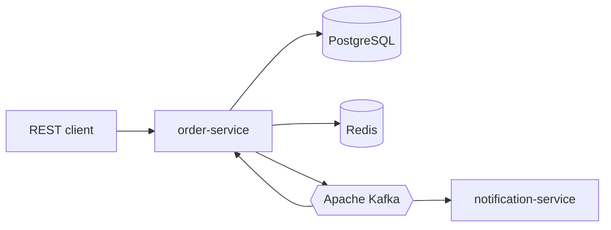

# Market Platform

Учебный, но production-like backend маркетплейса / доставки еды. Жизненный цикл заказа идёт через Kafka: transactional outbox, идемпотентные consumer-ы, компенсации при отмене.

Реализованы шаги 0–8: каталог, корзина, заказы, outbox/Kafka, mock payment, cancel saga, notification, JWT + rate limit.

## Стек

- Java 21, Spring Boot 3.5, Maven
- PostgreSQL 16, Redis 7, Apache Kafka 3.9 (KRaft)
- Flyway, Spring Data JPA, Spring Kafka, Actuator
- Testcontainers (Postgres, Redis, Kafka) в профиле `test`

## Kafka обязательна

Основной поток заказа публикуется в Kafka. Профиль `local` подключается к брокеру из Compose и **не стартует**, если брокер недоступен (`spring.kafka.admin.fail-fast=true`). Профиль `test` поднимает Kafka через Testcontainers. In-memory брокера нет.

Основная цепочка:

`POST /orders` → PostgreSQL + `outbox` → `order.events` → mock payment → `payment.events` → статус заказа → `order.events` → **notification-service** (лог + email stub).

Топики: `order.events`, `payment.events`, `catalog.events` (резерв и возврат stock). Решения и роли producer/consumer — в [docs/architecture.md](docs/architecture.md).

## Схема сервисов



Deployable: **`order-service`** (8080), **`notification-service`** (8081). Контракты событий — модуль `common-events`.

| Модуль | Сейчас |
|--------|--------|
| `common-events` | События order / payment / catalog |
| `order-service` | REST, outbox, Kafka consumers payment/stock |
| `notification-service` | Только Kafka consumer на `order.events` |

## Требования

- JDK 21 (сборка закреплена на 21, JDK 22+ не подходит)
- Docker с Compose v2 (для `local` и для `./mvnw verify`)

Если `java -version` показывает другую версию, выставьте `JAVA_HOME` на JDK 21 перед `./mvnw`.

## Локальный запуск

```bash
docker compose up -d
./mvnw -pl order-service -am -DskipTests install
./mvnw -pl order-service spring-boot:run -Dspring-boot.run.profiles=local
```

Notification (второй терминал, тот же Compose):

```bash
./mvnw -pl notification-service -am -DskipTests install
./mvnw -pl notification-service spring-boot:run -Dspring-boot.run.profiles=local
```

Проверка order-service:

```bash
curl -s http://localhost:8080/actuator/health
curl -s http://localhost:8080/actuator/health/readiness
```

Ожидание: `status` = `UP`, в `components` есть `db`, `redis`, `kafka` со статусом `UP`.

Остановка приложения: Ctrl+C. Остановка инфраструктуры: `docker compose down`.

Переменные окружения — в `.env.example`. Файл `.env` в git не коммитится. Значения по умолчанию совпадают с Compose.

## Тесты

```bash
./mvnw verify
```

Нужен запущенный Docker: интеграционные тесты поднимают Postgres, Redis и Kafka через Testcontainers.

## Catalog API (шаг 1)

- `GET /api/v1/categories`, `GET /api/v1/categories/{id}`
- `GET /api/v1/products`, `GET /api/v1/products/{id}` (фильтр `categoryId`, пагинация)
- `POST /api/v1/categories`, `POST /api/v1/products`, `PUT /api/v1/products/{id}`, `PUT /api/v1/products/{id}/stock`
- OpenAPI: [http://localhost:8080/swagger-ui/index.html](http://localhost:8080/swagger-ui/index.html)
- Seed: 3 категории, 4 товара (см. `V3__catalog_seed.sql`)

## Cart API (шаг 2)

Ключ корзины — `ownerId` (user id или session id в path):

- `GET /api/v1/carts/{ownerId}`
- `POST /api/v1/carts/{ownerId}/items` — добавить количество (merge)
- `PUT /api/v1/carts/{ownerId}/items/{productId}` — задать количество
- `DELETE /api/v1/carts/{ownerId}/items/{productId}`, `DELETE /api/v1/carts/{ownerId}`

Данные в Redis (`market.cart.ttl`, по умолчанию 7 дней). Остаток проверяется по PostgreSQL (не по cache каталога).

## Orders API (шаг 3)

- `POST /api/v1/orders` — body `{ "ownerId": "..." }`, header **`Idempotency-Key`** (8–128 символов)
- Статус заказа: **`PENDING_PAYMENT`** (оплата только через Kafka, шаг 4+)
- Корзина очищается после успешного создания; idempotency хранится в PostgreSQL (`ordering.idempotency_records`, TTL 24h)
- Остаток **проверяется** по PG, **резерв** — позже через `catalog.events`

## Kafka — payment flow (шаг 4–5)

| Топик | Producer | Consumer |
|-------|----------|----------|
| `order.events` | Outbox: `OrderCreated`, `OrderPaid` | `OrderCreatedPaymentConsumer` |
| `payment.events` | `OrderCreatedPaymentConsumer`, `MockPaymentGatewayConsumer` | `MockPaymentGatewayConsumer`, `OrderPaymentResultConsumer` |

Идempotency: `ordering.processed_events` (`consumer_name`, `event_id`).

## Cancel saga (шаг 6)

- `POST /api/v1/orders/{orderId}/cancel` — outbox **`OrderCancelled`** → `order.events`
- Оплаченный заказ: **`StockReleased`** на `catalog.events`, refund stub **`PaymentRefundRequested`** → **`PaymentRefunded`** на `payment.events`
- Диаграмма: [docs/saga-order-flow.md](docs/saga-order-flow.md)

## Notification (шаг 7)

| Топик | Producer | Consumer |
|-------|----------|----------|
| `order.events` | Outbox (`OrderCreated`, `OrderPaid`, `OrderCancelled`) | `notification-service` (`OrderEventNotificationConsumer`) |
| `order.events.dlq` | Spring Kafka DLT после retry | — |

- Схема PostgreSQL **`notification`**: `delivered_notifications`, `processed_events`
- Доставка: лог + **EMAIL_STUB** (без HTTP к order-service)
- Идempotency: `notification.processed_events` (`notification-order-events`, `event_id`)
- Health: `http://localhost:8081/actuator/health` (`db`, `kafka`)

## Security (шаг 8)

- **JWT** (HS256): `Authorization: Bearer …`
- **Demo token** (local/test): `POST /api/v1/auth/demo-token` — body `{ "subject": "user-1", "roles": ["USER"] }` (для админ-записей в каталог — `["ADMIN"]`)
- **Публично**: GET `/api/v1/categories`, `/api/v1/products`, корзина
- **Заказы**: JWT обязателен; `ownerId` в `POST /api/v1/orders` должен совпадать с `subject` токена
- **Rate limit**: Redis на создание заказа (по умолчанию **30/min** на пользователя) → **429**
- Секрет: `JWT_SECRET` в `.env` (см. `.env.example`)

Пример checkout:

```bash
TOKEN=$(curl -s -X POST http://localhost:8080/api/v1/auth/demo-token \
  -H 'Content-Type: application/json' \
  -d '{"subject":"demo-user","roles":["USER"]}' | jq -r .accessToken)
curl -s -X POST http://localhost:8080/api/v1/orders \
  -H "Authorization: Bearer $TOKEN" \
  -H 'Idempotency-Key: demo-checkout-001' \
  -H 'Content-Type: application/json' \
  -d '{"ownerId":"demo-user"}'
```

## Чего ещё нет

- Полная observability / E2E док (шаг 9)
