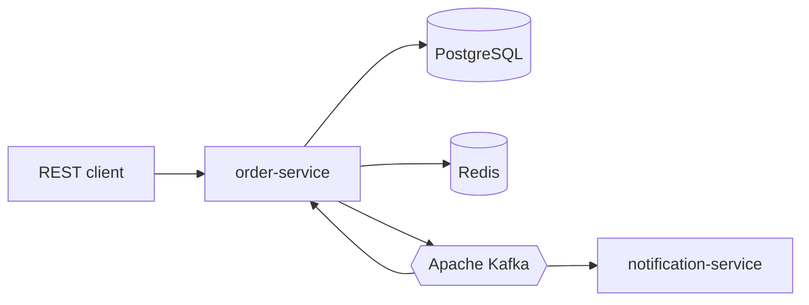

# Market Platform

Учебный, но production-like backend маркетплейса / доставки еды. Жизненный цикл заказа идёт через Kafka: transactional outbox, идемпотентные consumer-ы, компенсации при отмене.

Реализованы шаги 0–9: полный event-driven поток, security, observability (Prometheus) и E2E-док.

## Стек

- Java 21, Spring Boot 3.5, Maven
- PostgreSQL 16, Redis 7, Apache Kafka 3.9 (KRaft)
- Flyway, Spring Data JPA, Spring Kafka, Actuator
- Testcontainers (Postgres, Redis, Kafka) в профиле `test`

## Kafka обязательна

Основной поток заказа публикуется в Kafka. Профиль `local` подключается к брокеру из Compose и **не стартует**, если брокер недоступен (`spring.kafka.admin.fail-fast=true`). Профиль `test` поднимает Kafka через Testcontainers. In-memory брокера нет.

Основная цепочка:

`POST /orders` → PostgreSQL + `outbox` → `order.events` → mock payment → `payment.events` → статус заказа → `order.events` → **notification-service** (лог + email stub).

Топики: `order.events`, `payment.events`, `catalog.events` (резерв и возврат stock). Решения и роли producer/consumer — в [docs/architecture.md](docs/architecture.md).

## Схема сервисов



Deployable: **`order-service`** (8080), **`notification-service`** (8081). Контракты событий — модуль `common-events`.

| Модуль | Сейчас |
|--------|--------|
| `common-events` | События order / payment / catalog |
| `order-service` | REST, outbox, Kafka consumers payment/stock |
| `notification-service` | Только Kafka consumer на `order.events` |

## Требования

- JDK 21 (сборка закреплена на 21, JDK 22+ не подходит)
- Docker с Compose v2 (для `local` и для `./mvnw verify`)

Если `java -version` показывает другую версию, выставьте `JAVA_HOME` на JDK 21 перед `./mvnw`.

## Локальный запуск

### 1. Инфраструктура (Compose)

```bash
docker compose up -d
```

Postgres **5432**, Redis **6379**, Kafka **9092**. Переменные — `.env.example` (можно скопировать в `.env`; файл в git не коммитится).

### 2. Backend на хосте

Сборка (один раз или после изменений Java):

```bash
./mvnw -pl order-service -am -DskipTests install
./mvnw -pl notification-service -am -DskipTests install
```

**Терминал A — order-service (8080):**

```bash
./mvnw -pl order-service spring-boot:run -Dspring-boot.run.profiles=local
```

**Терминал B — notification-service (8081):**

```bash
./mvnw -pl notification-service spring-boot:run -Dspring-boot.run.profiles=local
```

Важно: для `spring-boot:run` указывайте **только** `-pl order-service` или `-pl notification-service`. Флаг `-am` на `spring-boot:run` с корневого POM пытается запустить parent без main class.

Альтернатива — fat jar:

```bash
./mvnw -pl order-service -am -DskipTests package
java -jar order-service/target/order-service-0.1.0-SNAPSHOT.jar --spring.profiles.active=local
```

### 3. Проверка readiness

```bash
curl -s http://localhost:8080/actuator/health/readiness
curl -s http://localhost:8081/actuator/health/readiness
curl -s 'http://localhost:8080/api/v1/products?size=1' | head -c 120
```

Ожидание: `db`, `redis`, `kafka` — **UP** (order); каталог — JSON с `content`, не **401** / **500**.

### 4. Demo UI (опционально)

- **Vite (dev):** `cd frontend && npm install && npm run dev` → http://localhost:5173  
- **Docker (nginx):** backend на **хосте** 8080/8081, затем  
  `docker compose --profile demo up -d --build demo-ui` → http://localhost:3000  

Подробнее: [docs/demo-ui.md](docs/demo-ui.md).

### Остановка

| Что | Команда |
|-----|---------|
| Java-приложения | Ctrl+C в терминалах или `lsof -ti :8080,:8081 \| xargs kill` |
| UI в Docker | `docker compose --profile demo stop demo-ui` |
| Вся инфра Compose | `docker compose down` (volume Postgres сохраняется) |
| UI + инфра | `docker compose --profile demo down` |

Полный сценарий checkout и отмены: [docs/e2e-local-flow.md](docs/e2e-local-flow.md).

### Если каталог отвечает 401 или 500

Часто это не security, а **500 на `/api/v1/products`** (Redis-кэш каталога после смены сериализации). Сброс кэша:

```bash
docker exec market-redis redis-cli FLUSHDB
```

Затем снова `curl` каталога. Подробнее — [docs/demo-ui.md](docs/demo-ui.md#устранение-неполадок).

## Тесты

```bash
./mvnw verify
```

Нужен запущенный Docker: интеграционные тесты поднимают Postgres, Redis и Kafka через Testcontainers.

## Catalog API (шаг 1)

- `GET /api/v1/categories`, `GET /api/v1/categories/{id}`
- `GET /api/v1/products`, `GET /api/v1/products/{id}` (фильтр `categoryId`, пагинация)
- `POST /api/v1/categories`, `POST /api/v1/products`, `PUT /api/v1/products/{id}`, `PUT /api/v1/products/{id}/stock`
- OpenAPI: [http://localhost:8080/swagger-ui/index.html](http://localhost:8080/swagger-ui/index.html)
- Seed: 3 категории, 4 товара (см. `V3__catalog_seed.sql`)

## Cart API (шаг 2)

Ключ корзины — `ownerId` (user id или session id в path):

- `GET /api/v1/carts/{ownerId}`
- `POST /api/v1/carts/{ownerId}/items` — добавить количество (merge)
- `PUT /api/v1/carts/{ownerId}/items/{productId}` — задать количество
- `DELETE /api/v1/carts/{ownerId}/items/{productId}`, `DELETE /api/v1/carts/{ownerId}`

Данные в Redis (`market.cart.ttl`, по умолчанию 7 дней). Остаток проверяется по PostgreSQL (не по cache каталога).

## Orders API (шаг 3+)

- `POST /api/v1/orders` — body `{ "ownerId": "..." }`, header **`Idempotency-Key`** (8–128 символов), **JWT**
- `GET /api/v1/orders` — список заказов текущего пользователя (`sub` токена), пагинация
- `GET /api/v1/orders/{id}` — заказ по id (только владелец)
- `POST /api/v1/orders/{id}/cancel` — отмена (JWT, владелец)
- Статус после создания: **`PENDING_PAYMENT`**; mock payment через Kafka → **`PAID`**
- Корзина очищается после успешного создания; idempotency — `ordering.idempotency_records` (TTL 24h)
- Остаток **проверяется** по PG; **резерв** — через `catalog.events`

### Admin (JWT role ADMIN)

| Endpoint | Сервис | Описание |
|----------|--------|----------|
| `GET /api/v1/admin/orders` | order **8080** | Все заказы, фильтр `?status=PAID` |
| `GET /api/v1/admin/notifications` | notification **8081** | Журнал доставленных уведомлений |

## Kafka — payment flow (шаг 4–5)

| Топик | Producer | Consumer |
|-------|----------|----------|
| `order.events` | Outbox: `OrderCreated`, `OrderPaid` | `OrderCreatedPaymentConsumer` |
| `payment.events` | `OrderCreatedPaymentConsumer`, `MockPaymentGatewayConsumer` | `MockPaymentGatewayConsumer`, `OrderPaymentResultConsumer` |

Идempotency: `ordering.processed_events` (`consumer_name`, `event_id`).

## Cancel saga (шаг 6)

- `POST /api/v1/orders/{orderId}/cancel` — outbox **`OrderCancelled`** → `order.events`
- Оплаченный заказ: **`StockReleased`** на `catalog.events`, refund stub **`PaymentRefundRequested`** → **`PaymentRefunded`** на `payment.events`
- Диаграмма: [docs/saga-order-flow.md](docs/saga-order-flow.md)

## Notification (шаг 7)

| Топик | Producer | Consumer |
|-------|----------|----------|
| `order.events` | Outbox (`OrderCreated`, `OrderPaid`, `OrderCancelled`) | `notification-service` (`OrderEventNotificationConsumer`) |
| `order.events.dlq` | Spring Kafka DLT после retry | — |

- Схема PostgreSQL **`notification`**: `delivered_notifications`, `processed_events`
- Доставка: лог + **EMAIL_STUB** (без HTTP к order-service)
- Идempotency: `notification.processed_events` (`notification-order-events`, `event_id`)
- Health: `http://localhost:8081/actuator/health` (`db`, `kafka`)

## Security (шаг 8)

- **JWT** (HS256): `Authorization: Bearer …`
- **Demo token** (local/test): `POST /api/v1/auth/demo-token` — body `{ "subject": "user-1", "roles": ["USER"] }` (для админ-записей в каталог — `["ADMIN"]`)
- **Публично**: GET `/api/v1/categories`, `/api/v1/products` (включая list без trailing slash), корзина
- **CORS** (для SPA): `http://localhost:5173`, `http://localhost:3000` — `market.cors.allowed-origins`
- **Заказы**: JWT обязателен; `ownerId` в `POST /api/v1/orders` должен совпадать с `subject` токена
- **Rate limit**: Redis на создание заказа (по умолчанию **30/min** на пользователя) → **429**
- Секрет: `JWT_SECRET` в `.env` (см. `.env.example`)

Пример checkout:

```bash
TOKEN=$(curl -s -X POST http://localhost:8080/api/v1/auth/demo-token \
  -H 'Content-Type: application/json' \
  -d '{"subject":"demo-user","roles":["USER"]}' | jq -r .accessToken)
curl -s -X POST http://localhost:8080/api/v1/orders \
  -H "Authorization: Bearer $TOKEN" \
  -H 'Idempotency-Key: demo-checkout-001' \
  -H 'Content-Type: application/json' \
  -d '{"ownerId":"demo-user"}'
```

## Demo UI (SPA)

React + Vite в **`frontend/`**: каталог, корзина, checkout, страница заказа (polling до **PAID**), admin — stock, заказы, notifications.

| Режим | URL | Когда |
|-------|-----|--------|
| `npm run dev` | http://localhost:5173 | Node.js на машине, hot reload |
| Compose `demo` | http://localhost:3000 | Только Docker; API на **хосте** 8080/8081 |

Подробнее: [docs/demo-ui.md](docs/demo-ui.md).

## Observability (шаг 9)

| Endpoint | Сервис |
|----------|--------|
| `/actuator/prometheus` | order **8080**, notification **8081** |
| `/actuator/metrics` | JSON-имена метрик |
| `/actuator/health` | readiness: db, redis, kafka |

- **Prometheus** (опционально): `docker compose --profile observability up -d` → http://localhost:9090
- **Метрики**: `market_orders_created_total`, `market_notifications_delivered_total`
- **Трейс в логах**: заголовок `X-Request-Id`; в консоли `[req:… evt:…]`
- **E2E вручную**: [docs/e2e-local-flow.md](docs/e2e-local-flow.md)
