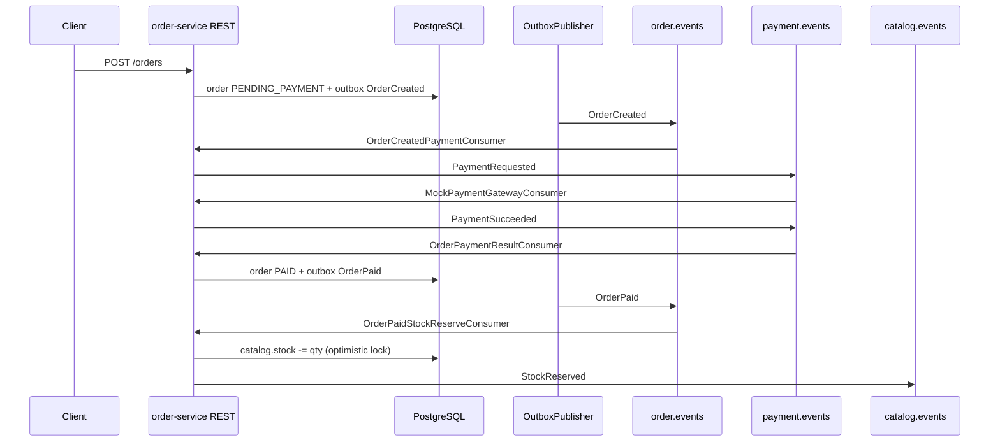
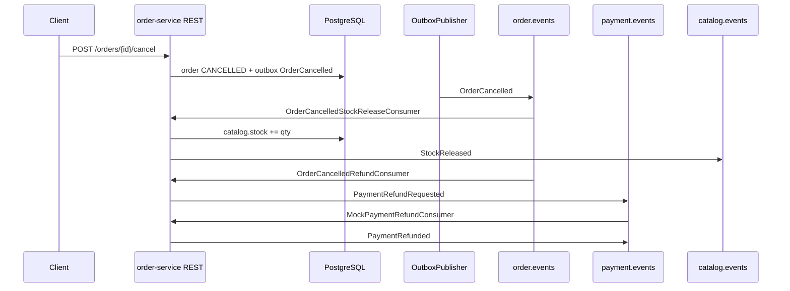

# Saga: order checkout and cancellation

Event-driven flow in `order-service` (modular monolith). Synchronous REST only starts or cancels the order; compensations are Kafka consumers.

## Happy path (checkout + payment)

## Cancel paid order (compensation)

## Rules

| Previous status | Stock on cancel | Payment compensation |
|-----------------|-----------------|----------------------|
| `PENDING_PAYMENT` | no release (stock not reserved yet) | none |
| `PAID` | `StockReleased` on `catalog.events` | `PaymentRefundRequested` → mock `PaymentRefunded` |

Stock reservation happens on **`OrderPaid`**, not on `OrderCreated`, so unpaid orders do not hold inventory.

Idempotency: every consumer records `(consumer_name, event_id)` in `ordering.processed_events`.

Domain outbox events (`OrderCreated`, `OrderPaid`, `OrderCancelled`) are written in the **same transaction** as the order row update.
